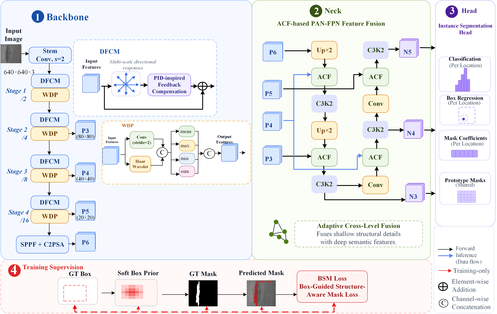

# FGPNet

**FGPNet** is a network for **infrared small target instance segmentation**. It follows a three-stage `Backbone → Neck → Head` design, introducing **physics-guided directional feature extraction** and **wavelet downsampling** in the backbone, **adaptive cross-layer fusion** in the neck, and training supervision through a **box-guided structure-aware mask loss**.

<p align="center">
  
</p>

---

## 1. Overall Architecture

FGPNet introduces four modifications over a generic detection/segmentation baseline:

| Stage | Modification | Module in Code | Purpose |
| --- | --- | --- | --- |
| Backbone | **DFCM** — Physics-Guided Directional Block | `PhysicsGuidedDirectionalBlock` | Multi-scale directional feature extraction + PID-style high-frequency feedback compensation |
| Backbone | **WDP** — Wavelet Downsampling | `ParallelWaveletConvDownsample` | The convolution path preserves contours, the wavelet high-frequency path rescues weak edges |
| Neck | **ACF** — Adaptive Cross-layer Fusion | `DP_CAF` | Dual spatial/channel Kalman gains that fuse shallow details with deep semantics |
| Training | **BSM Loss** | See Section 5 | Box-guided structure-aware mask loss |

---

## 2. Backbone

The input image is `640×640×3`. Each stage first applies stride-2 `WDP` downsampling, then `DFCM` for directional feature enhancement; the stage outputs are fed to the neck as multi-scale features.

```
Input (640×640×3)
   └─ WDP s=2                       → P1/2
        └─ WDP s=2 → DFCM ×2        → P2/4
             └─ WDP s=2 → DFCM ×2   → P3/8   (80×80)   ← shallow features fed to the neck
                  └─ WDP s=2 → DFCM ×2 → P4/16 (40×40)  ← mid-level features fed to the neck
                       └─ WDP s=2 → DFCM ×2 → P5/32 (20×20)
                            └─ SPFF + C2PSA → P6        ← deep features fed to the neck
```

`SPPF` and `C2PSA` follow the upstream Ultralytics framework implementation; the former aggregates multi-scale context at the highest level, while the latter introduces spatial attention. In the YAML, `PhysicsGuidedDirectionalBlock` takes `[c2, c3k, e]`: `c3k` is the C3k variant switch (currently unused in the forward pass), and `e` is the hidden-channel expansion ratio (0.5 for deep stages, 0.25 for P2/4 and P3/8, used to control the parameter count).

### 2.1 DFCM — Physics-Guided Directional Block

Three components connected in series:

1. **Multi-scale directional extraction (ASP branch)**
   `SingleBranchPhysicsGuidedExtractor` splits the input channels into three groups, sends them through depthwise separable convolutions with dilation rates of `1 / 2 / 3`, and concatenates the multi-scale directional responses.

2. **PID high-frequency compensation (HFC-PID)**
   `HighFrequencyCompensationPID` organizes its operators following closed-loop PID logic:
   - **Derivative term D**: grouped convolutions use high-pass kernels at 0°, 45°, 90°, and 135°; summing their absolute values yields directional gradient energy;
   - **Integral term I**: a depthwise separable smoothing convolution estimates the local background;
   - **Feedback control**: `U = m_c · m_s · D + (x − I)`, where `m_s` is a spatial attention gate and `m_c` is a channel attention gate produced by GAP + Sigmoid;
   - **Zero-initialized residual**: `x + γ · δ`, with `γ` initialized to 0, so the main-branch representation is unaffected at the start of training.

3. **InlineBottleneck**: a regular bottleneck unit placed after the extractor.

### 2.2 WDP — Parallel Wavelet Convolution Downsampling

A dual-path downsampler designed for hairline, dim, low-contrast infrared small targets:

- **Path 1 (convolution)**: `Conv(c1, c2, k=3, s=2)`, preserving macro contours;
- **Path 2 (wavelet)**: native Haar kernels perform a 2×2 decomposition, producing four subbands `LL / LH / HL / HH`. The sum of the absolute values of the three high-frequency subbands is added back to the low-frequency band — `wavelet = LL + |LH| + |HL| + |HH|` — locking in crack energy already at the downsampling stage;
- **Statistical spatial attention (CASAB)**: `mean / max / min / sum` are computed along the channel dimension of the fused feature, stacked into 4 channels, and passed through a 7×7 large-kernel convolution to produce a spatial weight map. Because the `min` component precisely delineates hairline crack contours, this attention is especially sensitive to dim targets;
- **Channel integration**: `Conv(2·c2 → c2)` restores the channel count.

> When stride `s ≠ 2`, this module degenerates into a plain convolution.

---

## 3. Neck — PAN-FPN Based on ACF

The neck is bidirectional (upsampling + downsampling), and every cross-layer fusion node is handled by `ACF`.

- **Top-down**: `P6(P5/32) → Up×2 → ACF(P4) → C3K2 → Up×2 → ACF(P3) → C3K2 → N3`
- **Bottom-up**: `N3 → Conv s=2 → ACF(head P4) → C3K2 → N4(P4/16)`; `N4 → Conv s=2 → ACF(head P5) → C3K2 → N5(P5/32)`

### ACF — Adaptive Cross-layer Fusion (`DP_CAF`)

An improved bidirectional Kalman decentralized covariance module that uniformly handles two kinds of heterogeneous features — high-frequency shallow details and deep semantics:

1. **Size alignment**: the second input (the corresponding backbone feature) is bilinearly interpolated to the resolution of the first input (the semantic branch);
2. **Main path**: a lossless `Concat` that keeps all original information;
3. **Side path**: both inputs are projected to `c_mid` channels, and a high-frequency residual `fs_high = high_pass(fs) − fs` is computed;
4. **Noise modeling**:
   - process noise `Q` = gating × `sigmoid(local variance)`, reflecting the uncertainty of shallow high-frequency responses;
   - observation noise `R` = deep background uncertainty (`R = 1 − r_gate(fd)`);
   - both are normalized to `[0,1]`, resolving the Q/R dimensional mismatch;
5. **Dual gains**: the spatial gain `K_spatial = Q / (Q + R + ε)` is computed per pixel, the channel gain comes from GAP + Sigmoid, and their product yields `K_dual`;
6. **Decentralized covariance alignment**: the two feature streams are first spatially decentralized and L2-normalized, then a covariance matrix is computed and a learnable temperature `τ` is applied via softmax to obtain a projection matrix that realigns the two streams — L2 normalization also guarantees numerical stability under FP16 training;
7. **Kalman state update and output**: `fs_updated = fs_high + K_dual · (fs_aligned − fs_high)`, concatenated with `fd` and passed through `fusion_conv` to form a residual term; the final output is `identity_concat + res_patch`.

---

## 4. Head — Instance Segmentation Head

A four-branch parallel segmentation head:

- **Classification** (per position): class probabilities
- **Box regression** (per level): bounding-box offsets
- **Mask coefficients** (per position): 32-dimensional prototype coefficients
- **Prototype masks** (global): `32 × 160 × 160` prototype masks

---

## 5. Training Supervision — BSM Loss

BSM (Box-Guided Structure-Aware Mask) Loss introduces three **training-only** supervision paths (the red dashed lines in the figure):

```
GT Box ──→ Soft Box Prior ──┐
GT Mask ────────────────────┼──→ Predicted Mask ──→ BSM Loss
                             │
GT Box ──────────────────────┘
```

- **Soft Box Prior**: a Gaussian-like soft prior generated from the GT boxes, steering the network toward reasonable spatial attention from the very beginning of training;
- **GT Mask**: provides pixel-level structure supervision;
- **BSM Loss**: combines the box prior with mask structure, constraining the **boundary adherence** and **interior structural consistency** of the predicted masks, mitigating mask degradation caused by the low foreground/background contrast of infrared small targets.

> This loss is implemented in an external fork repository, `ultralytics-G`. The `FGP/` package in this repository is the baseline version and does not include the BSM Loss or Soft Box Prior implementations.

---

## 6. Repository Structure

```
FGPNet/
├── img/
│   └── FGPNet.png              # Architecture diagram
├── requirements.txt            # Runtime dependencies
├── train.py                    # Training entry point
├── VAL.py                      # Validation entry point
└── FGP/                        # FGPNet framework package (deeply customized from Ultralytics v8.4.60)
    ├── nn/
    │   ├── modules/
    │   │   ├── block.py        # PhysicsGuidedDirectionalBlock / HFC-PID / ASP extractor
    │   │   ├── conv.py         # ParallelWaveletConvDownsample / DP_CAF
    │   │   └── head.py         # Segment head
    │   └── tasks.py            # Registration of custom modules in parse_model
    ├── engine/                 # Trainer / validator / predictor / exporter
    ├── models/yolo/            # YOLO unified entry, detect and segment tasks
    ├── data/  utils/  optim/   # Datasets, utilities, optimizers
    ├── assets/                 # Default demo images
    └── cfg/
        ├── default.yaml        # Default hyperparameters
        ├── datasets/           # Example dataset configs
        └── models/11/
            └── FGP-seg.yaml    # FGPNet model definition
```

### Model Definition (`FGP/cfg/models/11/FGP-seg.yaml`)

```yaml
backbone:
  - [-1, 1, ParallelWaveletConvDownsample, [64, 3, 2]]      # 0-P1/2
  - [-1, 1, ParallelWaveletConvDownsample, [128, 3, 2]]     # 1-P2/4
  - [-1, 2, PhysicsGuidedDirectionalBlock, [256, False, 0.25]]
  - [-1, 1, ParallelWaveletConvDownsample, [256, 3, 2]]     # 3-P3/8
  - [-1, 2, PhysicsGuidedDirectionalBlock, [512, False, 0.25]]
  - [-1, 1, ParallelWaveletConvDownsample, [512, 3, 2]]     # 5-P4/16
  - [-1, 2, PhysicsGuidedDirectionalBlock, [512, True]]
  - [-1, 1, ParallelWaveletConvDownsample, [1024, 3, 2]]    # 7-P5/32
  - [-1, 2, PhysicsGuidedDirectionalBlock, [1024, True]]
  - [-1, 1, SPPF, [1024, 5]]                                 # 9
  - [-1, 2, C2PSA, [1024]]                                   # 10

head:
  - [-1, 1, nn.Upsample, [None, 2, "nearest"]]               # 11
  - [[-1, 6], 1, DP_CAF, [1]]                                # 12  fuse P4
  - [-1, 2, C3k2, [512, False]]                              # 13
  - [-1, 1, nn.Upsample, [None, 2, "nearest"]]               # 14
  - [[-1, 4], 1, DP_CAF, [1]]                                # 15  fuse P3
  - [-1, 2, C3k2, [256, False]]                              # 16  (P3/8)
  - [-1, 1, Conv, [256, 3, 2]]                               # 17
  - [[-1, 13], 1, DP_CAF, [1]]                               # 18  fuse P4
  - [-1, 2, C3k2, [512, False]]                              # 19  (P4/16)
  - [-1, 1, Conv, [512, 3, 2]]                               # 20
  - [[-1, 10], 1, DP_CAF, [1]]                               # 21  fuse P5
  - [-1, 2, C3k2, [1024, True]]                              # 22  (P5/32)
  - [[16, 19, 22], 1, Segment, [nc, 32, 256]]                # 23  segmentation head
```

> `DP_CAF` is specially handled in `parse_model`: `c2` is the sum of the channel counts of the two input branches, `c_mid` is half of it, and `forward` receives the tuple `(x_shallow, x_deep)` — in the YAML the first element is the semantic branch (after upsampling) and the second is the corresponding backbone feature.

---

## 7. Requirements

- Python 3.10+
- PyTorch 2.x (install the matching CUDA build for GPU training)
- Remaining dependencies are listed in `requirements.txt`

In mainland China, it is recommended to switch to a domestic PyPI mirror first:

```bash
pip config set global.index-url https://pypi.tuna.tsinghua.edu.cn/simple
pip install -r requirements.txt
```

This repository ships with the framework source code, so `import FGP` works right after cloning — no extra upstream package installation is needed.

---

## 8. Usage

### 8.1 Training

Modify the dataset paths in `train.py` to match your local setup:

```python
model_yaml_path = str(Path(__file__).parent / "FGP" / "cfg" / "models" / "11" / "FGP-seg.yaml")
data_yaml_path = r"F:\dataset\FIDMS_YOLO_721\dataset.yaml"
```

Then run:

```bash
python train.py
```

Key hyperparameters (current configuration in `train.py`):

| Parameter | Value | Description |
| --- | --- | --- |
| `imgsz` | 640 | Input resolution |
| `epochs` | 200 | Number of training epochs |
| `batch` | 12 | Batch size |
| `workers` | 10 | Number of data-loading threads |
| `device` | `"0"` | GPU index; use `"0,1,2,3"` for multi-GPU |
| `project` | `runs/FGPNet_exp` | Output directory |
| `amp` | enabled by default | Set `amp=False` if the training loss becomes NaN |

> If the architecture has changed substantially, comment out `model.load(...)` to skip loading pretrained weights.

### 8.2 Validation

Modify the weights and dataset paths in `VAL.py`, then run:

```bash
python VAL.py
```

Validation settings: `imgsz=640`, `batch=16`, `iou=0.6`, `rect=False`.

---

## 9. Output Artifacts

```
runs/
├── train/<name>/          # Training results
│   ├── weights/best.pt    # Best weights
│   ├── weights/last.pt    # Last-epoch weights
│   └── results.png        # Training curves
└── val/<name>/            # Validation results (mAP, confusion matrix, etc.)
```

---

## 10. Notes

- The dataset paths in `train.py` and `VAL.py` must be adapted to your local setup.
- The `FGP/` package already contains the implementations of DFCM / WDP / ACF and their registration in `parse_model`, so the model can be built and used for inference directly. **BSM Loss** and **Soft Box Prior** require the fork repository that contains their implementations for training.
- For small-target scenarios, keep `rect=False` during validation (as `VAL.py` is currently configured) so that images are uniformly resized to `640×640`; otherwise rectangular batching shrinks small targets further in the padded region.
- This package removes cloud-platform integration and anonymous telemetry reporting from the upstream code, so training never sends data to any external service.

---

## 11. References

- Upstream framework: https://docs.ultralytics.com
- Task documentation: https://docs.ultralytics.com/tasks/segment
- Architecture diagram: [`img/FGPNet.png`](img/FGPNet.png)

> This project is modified and customized from the open-source Ultralytics YOLO codebase and follows its AGPL-3.0 license.
